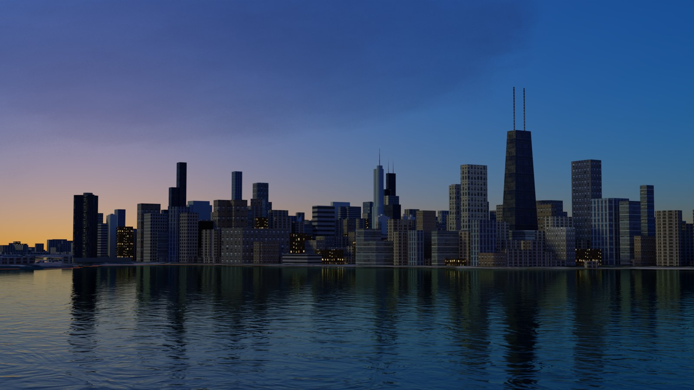
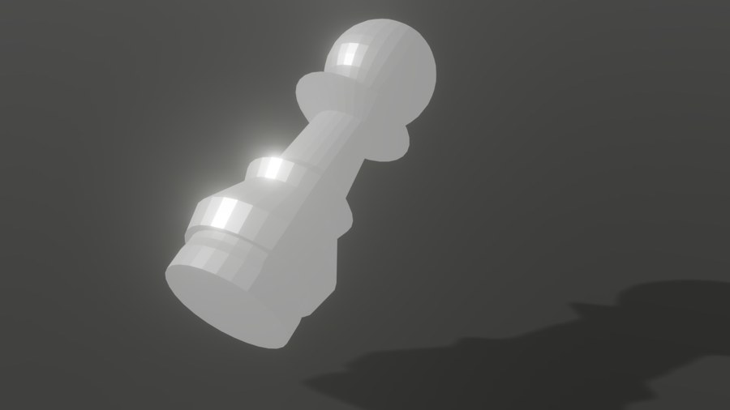
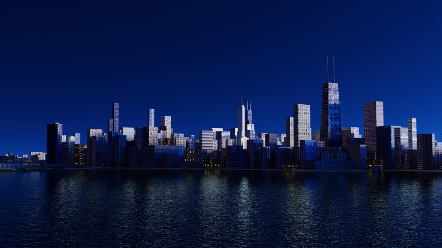
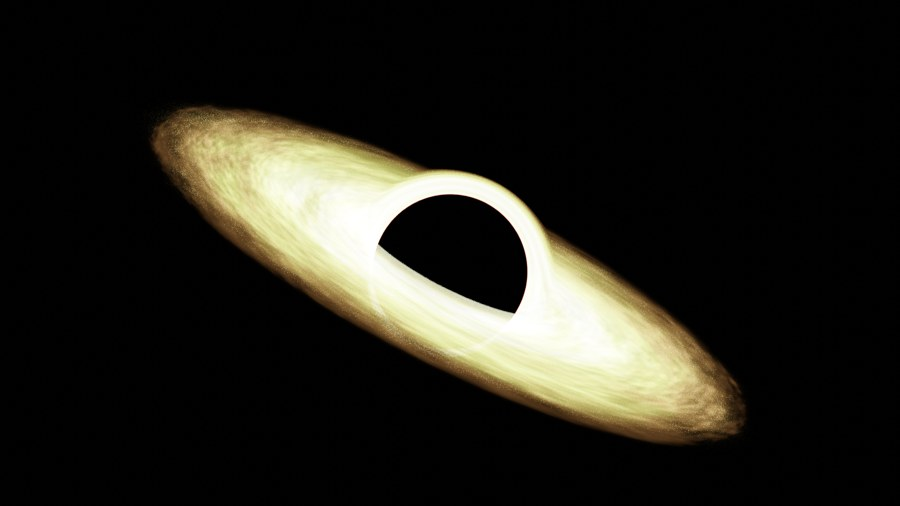
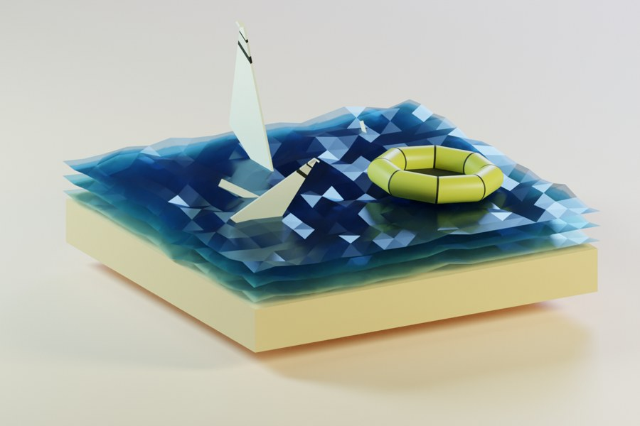
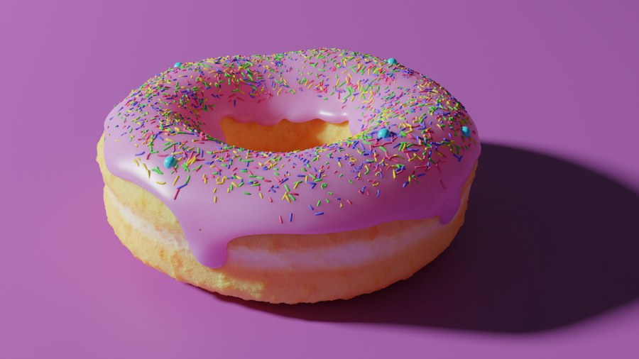
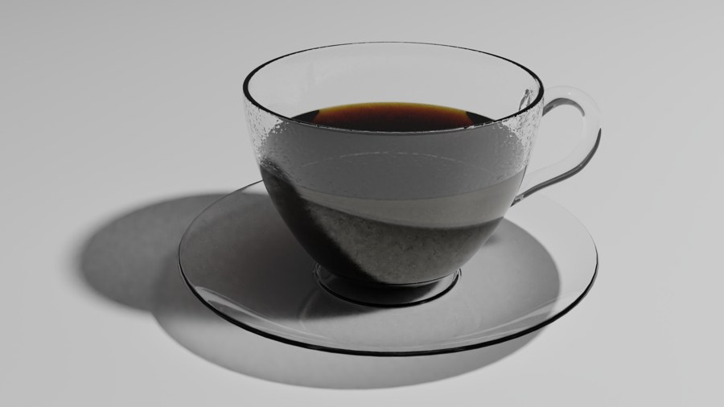
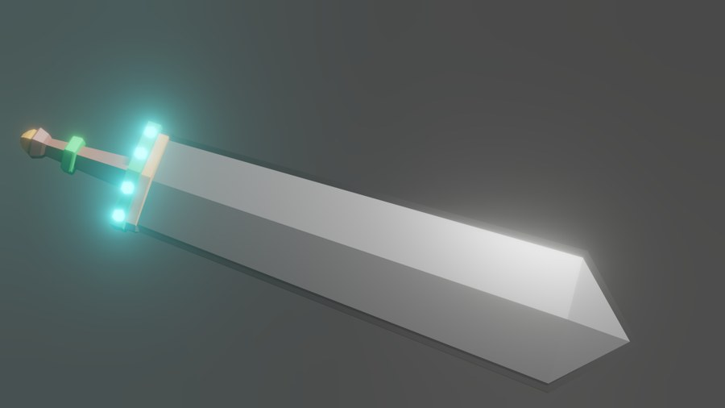
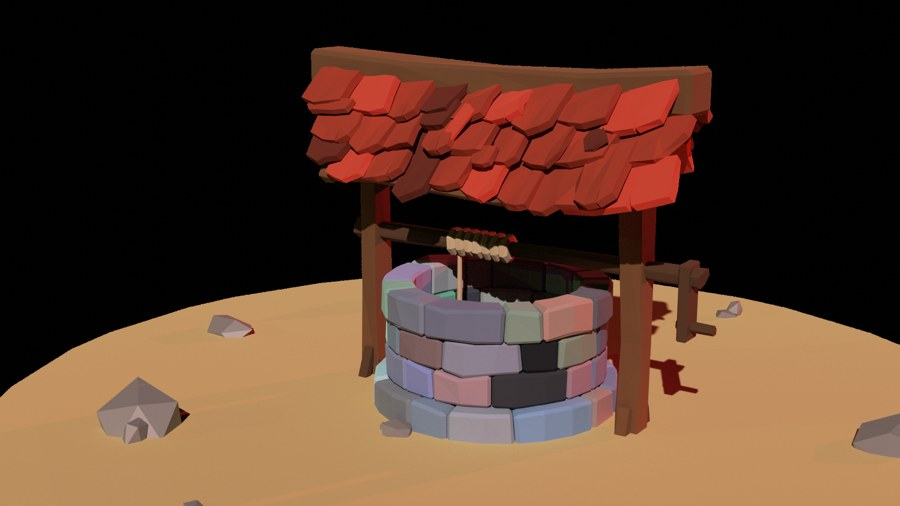

<div align="center">

# Blender Work

**Scenes, experiments, and a journey through 3D.**

A collection of my Blender projects and tutorial studies from **2019-2021**, spanning modeling, materials, lighting, environments, and animation.

[Projects](Blender%20Projects/) &nbsp; / &nbsp; [Tutorials](Blender%20Tutorials/) &nbsp; / &nbsp; [Open the files](#open-the-files)

</div>

[](Blender%20Projects/With%20Renders/2021/Wedding%20Card/Renders/Render%209.png)

*Wedding Card, 2021 - a waterfront skyline and its reflections. Select any showcase image to view the original render.*

## Selected renders

A mix of personal projects and tutorial work. Each study is part of the learning archive; tutorial pieces are identified below.

<table>
<tr>
<td width="50%" valign="top">
<a href="Blender%20Projects/With%20Renders/2019/Chess%20Piece/Renders/Chess_Piece_4.png"></a>
<br><strong>Chess Piece</strong><br>
<sub>Project / 2019</sub><br>
<a href="Blender%20Projects/With%20Renders/2019/Chess%20Piece">Explore the files</a>
</td>
<td width="50%" valign="top">
<a href="Blender%20Projects/With%20Renders/2021/Wedding%20Card/Renders/Render%201.png"></a>
<br><strong>Wedding Card - blue hour</strong><br>
<sub>Project / 2021</sub><br>
<a href="Blender%20Projects/With%20Renders/2021/Wedding%20Card">Explore the files</a>
</td>
</tr>
<tr>
<td width="50%" valign="top">
<a href="Blender%20Tutorials/With%20Renders%20%28Completed%20Tutorials%29/2020/Black%20Hole%20Tutorial%20by%20Iridesium/Render%27s/Render%201.png"></a>
<br><strong>Black Hole</strong><br>
<sub>Tutorial / 2020</sub><br>
<a href="Blender%20Tutorials/With%20Renders%20%28Completed%20Tutorials%29/2020/Black%20Hole%20Tutorial%20by%20Iridesium">Explore the files</a>
</td>
<td width="50%" valign="top">
<a href="Blender%20Tutorials/With%20Renders%20%28Completed%20Tutorials%29/2020/Low-Poly%20Plane%20Crash%20Island/Render%27s/Render%203.png"></a>
<br><strong>Low-Poly Plane Crash Island</strong><br>
<sub>Tutorial / 2020</sub><br>
<a href="Blender%20Tutorials/With%20Renders%20%28Completed%20Tutorials%29/2020/Low-Poly%20Plane%20Crash%20Island">Explore the files</a>
</td>
</tr>
<tr>
<td width="50%" valign="top">
<a href="Blender%20Tutorials/With%20Renders%20%28Completed%20Tutorials%29/2019/Donut%20Tutorial%20-%20Uncompleted/Renders/Render%205%20%28%20Level%202%20%29.png"></a>
<br><strong>Donut Study</strong><br>
<sub>Tutorial / 2019</sub><br>
<a href="Blender%20Tutorials/With%20Renders%20%28Completed%20Tutorials%29/2019/Donut%20Tutorial%20-%20Uncompleted">Explore the files</a>
</td>
<td width="50%" valign="top">
<a href="Blender%20Tutorials/With%20Renders%20%28Completed%20Tutorials%29/2019/Donut%20Tutorial%20-%20Uncompleted/Renders/Render%209%20%28%20Level%203%20%29.png"></a>
<br><strong>Glass Coffee Cup</strong><br>
<sub>Tutorial / 2019</sub><br>
<a href="Blender%20Tutorials/With%20Renders%20%28Completed%20Tutorials%29/2019/Donut%20Tutorial%20-%20Uncompleted">Explore the files</a>
</td>
</tr>
<tr>
<td width="50%" valign="top">
<a href="Blender%20Tutorials/With%20Renders%20%28Completed%20Tutorials%29/2019/Sword%20Tutorial/Render%27s/Sword%20Render%206.png"></a>
<br><strong>Sword</strong><br>
<sub>Tutorial / 2019</sub><br>
<a href="Blender%20Tutorials/With%20Renders%20%28Completed%20Tutorials%29/2019/Sword%20Tutorial">Explore the files</a>
</td>
<td width="50%" valign="top">
<a href="Blender%20Tutorials/With%20Renders%20%28Completed%20Tutorials%29/2019/Low%20Poly%20Well/Renders/Render%203.png"></a>
<br><strong>Low Poly Well</strong><br>
<sub>Tutorial / 2019</sub><br>
<a href="Blender%20Tutorials/With%20Renders%20%28Completed%20Tutorials%29/2019/Low%20Poly%20Well">Explore the files</a>
</td>
</tr>
</table>

## Explore the archive

The original folder names and year-based organization are preserved.

| Collection | What's inside |
| --- | --- |
| [Projects with renders](Blender%20Projects/With%20Renders/) | Chess piece, cube animation, birthday card, and wedding card scenes, with their available render outputs. |
| [Projects without renders](Blender%20Projects/Without%20Renders/) | Early modeling experiments, including water bottles, a pencil, and other scene files. |
| [Tutorials with renders](Blender%20Tutorials/With%20Renders%20%28Completed%20Tutorials%29/) | Donut and coffee studies, a low-poly well, a sword, a black hole, stylized grass, and a plane crash island. |
| [Tutorials without renders](Blender%20Tutorials/Without%20Renders%20%28Uncompleted%20Tutorials%29/) | Work in progress, including a chair study, a sea shack, and early Blender exercises. |

**Archive note:** The historical folder labels describe how the files were stored. Having renders does not always mean a tutorial was finished: the donut folder, for example, is explicitly marked uncompleted.

## Open the files

1. Install [Blender](https://www.blender.org/download/) and [Git LFS](https://git-lfs.com/).
2. Clone the repository with its large assets:

   ```sh
   git lfs install
   git clone https://github.com/GameDevRaf/Blender-Work.git
   cd Blender-Work
   git lfs pull
   ```

3. Open a `.blend` file from the project or tutorial you want to explore. Keep the surrounding texture and reference folders in place.

These are historical scenes. Blender versions, add-ons, and render settings may differ between projects, so a recent Blender release may produce different results. If textures are missing, use **File > External Data > Find Missing Files** and point Blender at the relevant project folder. Generated simulation caches are excluded and may need to be baked again.

For a quick look, browse the images and existing videos in each scene's render folder. The README uses smaller JPEG previews; the original render files are retained alongside the scenes.

## Repository housekeeping

- Blender scenes, videos, and PureRef boards use Git LFS.
- Autosaves, numbered `.blend` backups, generated caches, operating system metadata, and duplicate backup folders are ignored. They are preserved locally if present.
- Textures, reference files, and existing asset notices stay with their projects.

## Credits and usage

Tutorial work follows exercises by their respective creators. Existing folder names credit **Iridesium** for the black hole tutorial and **Curtis Holt** for the stylized grass tutorial. Other tutorial authors are not identified in the archive, so attribution is left unspecified rather than guessed.

Third-party models, textures, references, and tutorial designs remain subject to their owners' terms. In particular, the chair reference collection includes a notice identifying **Fredericia** as the owner of the files and design IP; see the [included notice](Blender%20Tutorials/Without%20Renders%20%28Uncompleted%20Tutorials%29/2020/Chair%20Tutorial/Reference%20Photo%27s/Chair%20Reference%27s/license.txt).

This repository is shared as a portfolio and learning archive. No blanket reuse license is granted; contact the owner before reusing original work and check any third-party terms separately.
